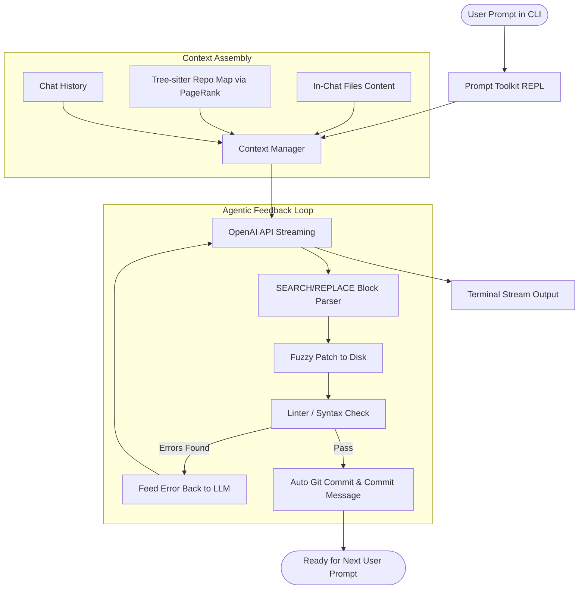

# Building an Aider-like Agentic Coding Assistant from Scratch
## An 8-Week Granular Roadmap: From Python Basics to Autonomous Pair Programmer

---

> [!IMPORTANT]
> **Current Progress Status**:
> - ✅ **Week 1 (COMPLETED)**: Environment setup (`uv`), `.env`, dependencies, streaming LLM client (`llm.py`), and REPL (`main.py`).
> - ✅ **Week 2 (COMPLETED)**: Git Discovery (`repo.py`), File Ingestion (`context.py`), Token Budgeting (`tiktoken`), and Slash Commands (`/add`, `/drop`, `/tokens`, `/clear`).
> - 🚀 **Week 3 (READY TO START)**: The Edit Engine — SEARCH/REPLACE Block Patcher.

---

[Aider](https://github.com/Aider-AI/aider) is a terminal-based AI pair programmer that can inspect your local Git repository, edit code across multiple files, run linters and tests, and commit clean changes automatically.

Building an agentic coding tool from scratch is one of the best ways to master modern Python and AI engineering. Rather than relying on rigid orchestration frameworks (like LangChain or AutoGen), Aider succeeds because of **fine-grained context management**, **precise diff application algorithms**, and a **tight feedback loop with local developer tools (Git, linters, tests)**.

### How an Aider-like Agent Operates



---

## 2. Tech Stack & Prerequisites

### Prerequisites for You
- Basic knowledge of Python (functions, loops, dicts, lists, basic OOP classes).
- An OpenAI API Key (`OPENAI_API_KEY`).
- Git installed on your machine.

### Core Libraries Used
| Domain | Library | Purpose |
| :--- | :--- | :--- |
| **Package Manager** | `uv` | Blazing-fast virtual environment & dependency management |
| **LLM Client** | `openai` | Official SDK with streaming completions |
| **Token Tracking** | `tiktoken` | Exact BPE token counting for OpenAI models |
| **Terminal UI** | `prompt_toolkit` + `rich` | Syntax highlighting, autocompletion, multiline REPL |
| **Git Operations** | `GitPython` / `git` CLI | Programmatic commit, diff, status, and undo |
| **Code Parsing** | `tree-sitter` & `tree-sitter-python` | Language-agnostic AST parsing for symbol extraction |
| **Graph Analysis** | `networkx` | PageRank algorithm to rank relevant code symbols |
| **Caching** | `diskcache` / `sqlite3` | Persistent caching for AST tags and token counts |

---

## 3. Project Architecture (Target State by Week 8)

```text
micro-coder/
├── pyproject.toml              # Project dependencies and CLI entrypoint
├── README.md
├── .env                        # OPENAI_API_KEY
├── .gitignore
├── src/
│   └── micro_coder/
│       ├── __init__.py
│       ├── main.py             # CLI entrypoint & argument parsing
│       ├── io/
│       │   ├── __init__.py
│       │   ├── terminal.py     # prompt_toolkit REPL & rich styling
│       │   └── completer.py    # Path & slash command autocompletion
│       ├── core/
│       │   ├── __init__.py
│       │   ├── agent.py        # Main agent orchestration loop
│       │   ├── llm.py          # OpenAI streaming client & retry handler
│       │   ├── context.py      # Token budgeting & active file tracking
│       │   └── prompts.py      # System prompts & diff instructions
│       ├── edit/
│       │   ├── __init__.py
│       │   ├── parser.py       # SEARCH/REPLACE block extractor
│       │   └── patcher.py      # Exact & fuzzy diff disk patcher
│       ├── git/
│       │   ├── __init__.py
│       │   └── repo.py         # Git repo discovery, status, auto-commit, undo
│       ├── repomap/
│       │   ├── __init__.py
│       │   ├── parser.py       # Tree-sitter AST symbol extractor
│       │   ├── graph.py        # NetworkX PageRank symbol graph
│       │   └── cache.py        # SQLite / diskcache for AST tags
│       └── tools/
│           ├── __init__.py
│           ├── linter.py       # Syntax check & ruff / flake8 runner
│           └── tester.py       # pytest subprocess runner
└── tests/
    ├── test_parser.py          # Diff parser unit tests
    ├── test_patcher.py         # Fuzzy matching unit tests
    └── test_repomap.py         # Tree-sitter tag extraction tests
```

---

## 4. Week-by-Week Granular Roadmap

---

### Week 1: Environment, Modern Python with `uv` & Streaming LLM REPL

#### Goal
Set up a clean modern Python project using `uv`, authenticate with OpenAI, and build a terminal chat loop that streams tokens in real time.

#### Learning Objectives
- Why `uv` replaces `pip`, `venv`, and `poetry`.
- Understanding OpenAI's Chat Completions API schema (`system`, `user`, `assistant`).
- Python generators (`yield`) and handling streaming responses chunk-by-chunk.
- Graceful terminal interruptions (`Ctrl+C`, `EOF`).

#### Granular Tasks
1. **Initialize Project with `uv`**:
   ```bash
   mkdir micro-coder && cd micro-coder
   uv init --name micro-coder
   uv venv
   source .venv/bin/activate
   ```
2. **Add Core Dependencies**:
   ```bash
   uv add openai python-dotenv rich
   ```
3. **Environment Setup**:
   - Create `.env` containing `OPENAI_API_KEY=your_key_here`.
   - Add `.env` and `.venv/` to `.gitignore`.
4. **Implement the Streaming Client (`src/micro_coder/core/llm.py`)**:
   - Write a function `stream_chat(messages, model="gpt-4o") -> Generator[str, None, None]`.
   - Iterate over `client.chat.completions.create(stream=True)`.
   - Extract `chunk.choices[0].delta.content`.
5. **Build the Basic REPL (`src/micro_coder/main.py`)**:
   - Maintain a list: `messages: list[dict] = []`.
   - Collect input from the user using `rich.prompt.Prompt.ask`.
   - Stream the response to terminal with `rich.console.Console`.
   - Handle `KeyboardInterrupt` (`Ctrl+C`) cleanly without crashing.

#### Deliverable / Milestone
Run `uv run python -m micro_coder.main` and have a multi-turn conversation in your terminal where the assistant's answer streams character-by-character.

---

### Week 2: Git Integration, File Ingestion & Token Budgeting

#### Goal
Turn the chat into a code-aware assistant. Inspect local files, add/drop them from the active chat context, and calculate token counts accurately.

#### Learning Objectives
- Inspecting Git repositories programmatically using Python (`GitPython` or `subprocess`).
- BPE tokenization with `tiktoken` (how LLMs measure text length).
- Designing context payloads: framing source code with file paths and line boundaries.
- Basic slash command dispatching (`/add`, `/drop`, `/tokens`, `/clear`).

#### Granular Tasks
1. **Add Dependencies**:
   ```bash
   uv add gitpython tiktoken
   ```
2. **Git Repository Discovery (`src/micro_coder/git/repo.py`)**:
   - Write `find_git_root(path: str = ".") -> Path | None` by traversing upward until `.git` is found.
   - Write `get_repo_status() -> dict`: list modified, untracked, and staged files.
3. **Context Manager (`src/micro_coder/core/context.py`)**:
   - Maintain `active_files: set[Path]`.
   - Implement `add_file(path)` and `drop_file(path)` with path resolution relative to git root.
   - Read file contents safely (UTF-8 with error handling for binary files).
   - Format active files into prompt text:
     ````markdown
     # Active Files in Context:
     
     ## path/to/file.py
     ```python
     def hello():
         print("world")
     ```
     ````
4. **Token Budgeting (`src/micro_coder/core/context.py`)**:
   - Initialize `tiktoken.encoding_for_model("gpt-4o")`.
   - Count tokens for:
     1. System prompt
     2. In-context files
     3. Chat history
   - Warn the user if context exceeds a threshold (e.g. 50,000 tokens).
5. **Implement Slash Commands in REPL**:
   - `/add <filepath>`: Adds a file to context.
   - `/drop <filepath>`: Removes a file.
   - `/tokens`: Prints breakdown of current token consumption.
   - `/clear`: Resets chat history while keeping active files.

#### Deliverable / Milestone
Start your CLI inside any Git repo, run `/add main.py`, ask *"What does this file do?"*, and receive an accurate answer based solely on the ingested file.

---

### Week 3: The Edit Engine — SEARCH/REPLACE Block Patcher

#### Goal
Master the single most critical capability of Aider: generating, parsing, and applying localized `SEARCH/REPLACE` blocks without rewriting entire files.

#### Learning Objectives
- Why whole-file generation fails for real coding (latency, cost, truncation, hallucination).
- The syntax of Aider's SEARCH/REPLACE blocks.
- Writing deterministic parsers using regex and state machines.
- Implementing exact matching and fuzzy matching fallback using `difflib`.

#### Granular Tasks
1. **Understanding the Format**:
   ```text
   path/to/file.py
   <<<<<<< SEARCH
   original lines of code
   =======
   modified lines of code
   >>>>>>> REPLACE
   ```
2. **Prompt Engineering (`src/micro_coder/core/prompts.py`)**:
   - Craft the system instructions:
     - *"Always output code edits in SEARCH/REPLACE blocks."*
     - *"The SEARCH block must match EXACT lines from the existing file, including indentation."*
     - *"Do not include line numbers in the SEARCH block."*
3. **The Parser (`src/micro_coder/edit/parser.py`)**:
   - Create a dataclass `EditBlock(filepath: str, search_text: str, replace_text: str)`.
   - Implement `parse_edit_blocks(response_text: str) -> list[EditBlock]`.
   - Handle edge cases: multiple blocks for the same file, missing filename header, whitespace variations.
4. **The Patcher (`src/micro_coder/edit/patcher.py`)**:
   - Step 1: **Exact Match**: `content.replace(search_text, replace_text, 1)`.
   - Step 2: **Fuzzy Match Fallback**:
     - If exact match fails, normalize line endings (`\r\n` -> `\n`).
     - Try stripping trailing whitespace line-by-line.
     - Use `difflib.SequenceMatcher` to locate the closest matching block in the file (threshold $\ge 0.85$).
5. **Safety & Disk Write**:
   - Create a backup copy before editing.
   - Atomic write: write to a temporary file first, then `os.replace` to prevent corrupted files on crash.

#### Deliverable / Milestone
Write a test script `test_patcher.py` with 10 sample code snippets and simulated LLM search/replace blocks (including messy whitespace). Verify that 100% of patches apply cleanly to disk.

---

### Week 4: Professional REPL (`prompt_toolkit`), Auto-Git Commits & Undo

#### Goal
Upgrade the user experience to professional standards: tab-completion, multiline input, auto-committing AI changes, and instant `/undo`.

#### Learning Objectives
- Terminal UX engineering with `prompt_toolkit`.
- Custom autocompletion for shell paths and slash commands.
- Generating semantic Git commit messages using the LLM.
- Git rollback techniques (`git reset` vs clean worktree verification).

#### Granular Tasks
1. **Add Dependency**:
   ```bash
   uv add prompt-toolkit
   ```
2. **Build Terminal REPL (`src/micro_coder/io/terminal.py`)**:
   - Use `prompt_toolkit.PromptSession`.
   - Enable persistent history saved to `~/.micro_coder_history`.
   - Implement `MicroCoderCompleter`:
     - Autocompletes slash commands when input starts with `/`.
     - Autocompletes local file paths after `/add` or `/drop`.
   - Support multiline input (e.g. `Meta+Enter` / `Esc+Enter` to submit, `Enter` for newline).
3. **Automated Git Commits (`src/micro_coder/git/repo.py`)**:
   - After patches apply to disk, run `git diff` to identify modified files.
   - If changes exist, call the LLM with a mini-prompt:
     *"Summarize these git diff changes into a concise Conventional Commit message (e.g. feat: ..., fix: ...). Output ONLY the commit message."*
   - Execute `git add <files>` and `git commit -m "<message>"`.
   - Display commit hash and message in terminal using `rich`.
4. **Implement `/undo`**:
   - When the user runs `/undo`, check if the last commit was created by the tool.
   - Run `git reset --hard HEAD~1` to roll back the commit and revert files.
   - Inform the user that the changes have been reverted.
5. **Implement `/diff`**:
   - Display the current uncommitted (or last committed) git diff formatted with syntax colors using `rich.syntax.Syntax`.

#### Deliverable / Milestone
In your CLI:
1. Type `/add main.py` using tab-completion.
2. Tell the tool: *"Add a docstring to main()"*.
3. Watch it modify the file and automatically create a commit: `docs: add docstring to main()`.
4. Type `/undo`, and watch your repository return to its exact prior state.

---

### Week 5: The Agentic Feedback Loop — Linting, Testing & Self-Healing

#### Goal
Transform the system from a passive generator into an **autonomous agent** that validates its own work, catches mistakes, and fixes them without human intervention.

#### Learning Objectives
- The Agentic Loop: **Act $\rightarrow$ Observe $\rightarrow$ Reflect $\rightarrow$ Fix**.
- Running external tools (`ruff`, `pytest`, `ast.parse`) via Python `subprocess`.
- Designing error-recovery prompts with tracebacks.
- Preventing infinite loops with recursion budgets.

#### Granular Tasks
1. **Add Fast Linter**:
   ```bash
   uv add ruff pytest
   ```
2. **Linter / Syntax Runner (`src/micro_coder/tools/linter.py`)**:
   - **Level 1 (Instant)**: Python `ast.parse(source_code)`. Catches raw syntax errors (`SyntaxError`, `IndentationError`) in 1 millisecond.
   - **Level 2 (Fast Linter)**: Subprocess call: `ruff check <filepath>`.
   - Extract error message, line number, and error code.
3. **Test Runner (`src/micro_coder/tools/tester.py`)**:
   - Run `pytest` on test files related to the modified files (or user-specified test suite).
   - Capture `stdout` and `stderr` when exit code $\neq 0$.
4. **The Self-Healing Loop (`src/micro_coder/core/agent.py`)**:
   - When edits apply to disk:
     ```python
     for attempt in range(max_retries):  # max_retries = 3
         errors = run_linter_and_tests(modified_files)
         if not errors:
             git_commit(...)
             break
         
         # Self-healing prompt
         feedback_prompt = f"""
         The previous edits introduced the following errors:
         {errors}
         
         Please fix these errors. Respond ONLY with SEARCH/REPLACE blocks.
         """
         response = call_llm(feedback_prompt)
         apply_patches(response)
     ```
5. **Safety Exit**:
   - If 3 attempts fail, do NOT commit. Ask the user: *"Failed to fix lint errors after 3 tries. Revert changes? (y/n)"*.

#### Deliverable / Milestone
Ask the model: *"Refactor helper function in test.py"*. If the model makes a syntax mistake or breaks an existing unit test, watch the agent automatically read the `pytest` output, output a correction block, pass the tests, and only then commit.

---

### Week 6: Codebase Awareness (Part 1) — Tree-sitter AST & Symbol Extraction

#### Goal
Understand how Aider can be aware of thousands of lines of code without loading entire files into chat. Extract definitions, classes, functions, and signatures using AST parsers.

#### Learning Objectives
- Why regex is insufficient for code understanding across languages.
- Abstract Syntax Trees (AST) and Tree-sitter fundamentals.
- Extracting symbol definitions (`@definition.function`, `@definition.class`).
- Creating skeletonized "elided" code views.
- Caching AST tags with file modification times (`mtime`) using SQLite or `diskcache`.

#### Granular Tasks
1. **Add Dependencies**:
   ```bash
   uv add tree-sitter tree-sitter-python diskcache
   ```
2. **Tree-sitter Setup (`src/micro_coder/repomap/parser.py`)**:
   - Initialize Python grammar:
     ```python
     from tree_sitter import Language, Parser
     import tree_sitter_python as tspython

     PY_LANGUAGE = Language(tspython.language())
     parser = Parser(PY_LANGUAGE)
     ```
3. **Extracting Definitions (`src/micro_coder/repomap/parser.py`)**:
   - Query the AST for:
     - Function definitions (`function_definition`)
     - Class definitions (`class_definition`)
     - Method definitions
   - Extract:
     - Symbol name
     - Parameters and return type annotations
     - Docstring summary (first line)
     - Line numbers
4. **Building Code Skeletons**:
   - Transform full file implementations into compact signature outlines:
     ```python
     class DatabaseManager:
         def __init__(self, db_path: str): ...
         def query(self, sql: str, params: tuple = ()) -> list[dict]: ...
     ```
5. **Persistent Tag Caching (`src/micro_coder/repomap/cache.py`)**:
   - Store parsed tags in `diskcache.Cache(".micro_coder_cache")`.
   - Key: `(file_path, file_mtime, file_size)`.
   - Result: Scanning a 200-file repository takes 5 seconds on first run, and 50 milliseconds on subsequent runs.
6. **Implement `/map` Command**:
   - Prints the extracted symbol skeleton of the repository to the terminal.

#### Deliverable / Milestone
Run `/map` on your repository and see a clean, compact structural outline of all functions, classes, and method signatures across all files.

---

### Week 7: Codebase Awareness (Part 2) — Symbol Graph, PageRank & Dynamic Context

#### Goal
Implement Aider's signature feature: the **Repository Map via Personalized PageRank**. Automatically feed the most relevant parts of the entire codebase into the LLM context.

#### Learning Objectives
- Understanding reference graphs (who calls whom, who imports what).
- Directed graphs with `networkx`.
- Personalized PageRank: biasing graph importance toward the files currently in chat.
- Token-budgeted map packing.

#### Granular Tasks
1. **Add Dependency**:
   ```bash
   uv add networkx
   ```
2. **Build the Dependency Graph (`src/micro_coder/repomap/graph.py`)**:
   - Extract definitions: where is function `calculate_tax` defined?
   - Extract references/identifiers: where is `calculate_tax` called or imported?
   - Construct directed graph $G = (V, E)$:
     - Nodes = Files and Symbols.
     - Edges = File A references Symbol B defined in File C.
3. **Personalized PageRank**:
   - Define personalization dictionary:
     - Active files in chat $\rightarrow$ weight $10.0$
     - Other files $\rightarrow$ weight $1.0$
   - Run `ranked_nodes = nx.pagerank(G, personalization=weights)`.
4. **Token-Budgeted Map Formatter (`src/micro_coder/repomap/repomap.py`)**:
   - Set a strict token budget (e.g. 1,024 or 2,048 tokens).
   - Sort symbols by PageRank score.
   - Greedily pack symbol skeletons into the prompt until the token budget is reached.
5. **Inject Repo Map into System Prompt**:
   - Inject the dynamic map into the system prompt:
     ````markdown
     # Repository Map (Key symbols and relationships in this project):
     db/conn.py:
       def get_connection() -> Connection: ...
     models/user.py:
       class User: ...
     ````

#### Deliverable / Milestone
Open your CLI without adding `utils.py` to chat. Ask: *"Call the helper function that formats timestamps in main.py"*. The LLM correctly references `format_timestamp()` with the exact arguments because the PageRank Repo Map gave it structural awareness!

---

### Week 8: Architect/Editor Pattern, Distribution & Capstone Project

#### Goal
Implement the two-stage Architect/Editor workflow (used by top benchmarks), package your tool into a standalone CLI binary via `uv`, and perform the ultimate test: use your tool to self-host!

#### Learning Objectives
- The Architect / Editor pattern (separating reasoning/planning from code emission).
- Packaging Python applications with `pyproject.toml` console scripts.
- Installing and running via `uv tool install`.
- Self-hosting and benchmarking.

#### Granular Tasks
1. **Implement Architect / Editor Mode (`src/micro_coder/core/agent.py`)**:
   - **Stage 1 (Architect)**: Call a reasoning model (or `gpt-4o` with reasoning prompt):
     - Prompt: *"Analyze the user request and codebase context. Devise an architectural plan and exact step-by-step modification specifications. Do NOT output code diffs yet."*
   - **Stage 2 (Editor)**: Pass the Architect's plan to the editing model:
     - Prompt: *"Here is the architectural plan: [Plan]. Generate exact SEARCH/REPLACE blocks to implement these specifications."*
   - Why: This separation drastically reduces hallucinated edits and syntax breakages on complex multi-file tasks.
2. **Add Practical Utilities**:
   - `/run <command>`: Run arbitrary shell command (e.g. `/run git status`).
   - `/web <url>`: Fetch a web page / documentation and add markdown text to context.
3. **CLI Packaging (`pyproject.toml`)**:
   - Configure entrypoint:
     ```toml
     [project.scripts]
     micro-coder = "micro_coder.main:cli"
     ```
4. **Global Installation**:
   ```bash
   uv tool install . --force
   ```
   Now `micro-coder` runs from any directory on your computer!
5. **Capstone Test (The Self-Hosting Milestone)**:
   - Navigate to the `micro-coder` project directory.
   - Launch your own tool: `micro-coder`.
   - Ask it to implement a new feature into itself (for example: `/tokens --detail` command to show cost in USD).
   - Review its edits, verify the self-healing tests, and commit!

---

## 5. Critical Code Recipes & Core Algorithms

### Recipe 1: The SEARCH/REPLACE Block Parser
Save this as a reference when building Week 3:

```python
import re
from dataclasses import dataclass

@dataclass
class EditBlock:
    filepath: str
    search_text: str
    replace_text: str

def parse_edit_blocks(response: str) -> list[EditBlock]:
    """
    Parses Aider-style SEARCH/REPLACE blocks.
    Format:
    filepath.py
    <<<<<<< SEARCH
    old code
    =======
    new code
    >>>>>>> REPLACE
    """
    pattern = re.compile(
        r"^(?P<filepath>[^\n\r`]+?)\n"
        r"<{5,9}\s*SEARCH\s*\n"
        r"(?P<search>[\s\S]*?)\n"
        r"={5,9}\s*\n"
        r"(?P<replace>[\s\S]*?)\n"
        r">{5,9}\s*REPLACE",
        re.MULTILINE
    )
    
    blocks = []
    for match in pattern.finditer(response):
        filepath = match.group("filepath").strip().strip("`*# ")
        search = match.group("search")
        replace = match.group("replace")
        blocks.append(EditBlock(filepath=filepath, search_text=search, replace_text=replace))
    return blocks
```

---

### Recipe 2: Fuzzy Patcher with Whitespace Normalization
Save this as a reference for handling LLM whitespace mismatches in Week 3:

```python
import difflib

def apply_patch(original_content: str, search_text: str, replace_text: str) -> str:
    # 1. Try Exact Match
    if search_text in original_content:
        return original_content.replace(search_text, replace_text, 1)

    # 2. Try Normalized Line Endings & Trailing Whitespace
    norm_orig_lines = [line.rstrip() for line in original_content.splitlines()]
    norm_search_lines = [line.rstrip() for line in search_text.splitlines()]
    
    norm_orig = "\n".join(norm_orig_lines)
    norm_search = "\n".join(norm_search_lines)
    
    if norm_search in norm_orig:
        start_idx = norm_orig.find(norm_search)
        prefix = norm_orig[:start_idx]
        start_line = prefix.count("\n")
        num_search_lines = len(norm_search_lines)
        
        orig_lines = original_content.splitlines(keepends=True)
        new_lines = (
            orig_lines[:start_line]
            + [replace_text + "\n"]
            + orig_lines[start_line + num_search_lines:]
        )
        return "".join(new_lines)
        
    raise ValueError("Failed to match SEARCH block in target file.")
```

---

### Recipe 3: Tree-sitter Python Function & Class Extractor
Reference for Week 6:

```python
from tree_sitter import Language, Parser
import tree_sitter_python as tspython

def extract_python_symbols(code_bytes: bytes):
    language = Language(tspython.language())
    parser = Parser(language)
    tree = parser.parse(code_bytes)
    
    query_str = """
    (class_definition name: (identifier) @class.name) @class.def
    (function_definition name: (identifier) @func.name) @func.def
    """
    query = language.query(query_str)
    captures = query.captures(tree.root_node)
    
    symbols = []
    for node, tag in captures:
        if tag in ("class.name", "func.name"):
            name = code_bytes[node.start_byte:node.end_byte].decode("utf-8")
            symbols.append({"type": tag.split(".")[0], "name": name, "line": node.start_point[0] + 1})
    return symbols
```

---

## 6. Token Budgeting & OpenAI Cost Optimization Tips

As a beginner building an agentic tool, keep these cost rules in mind:
1. **Never dump the whole project into the prompt**: A 5,000-line codebase will burn 25,000+ tokens on *every single keystroke*. Use `/add` selectively and rely on the Repo Map (1,024 tokens) for background awareness.
2. **Model Selection Strategy**:
   - Development & Testing: Use `gpt-4o-mini` while writing your parsers and CLI loops. It is ~30x cheaper and fast.
   - Production / Coding Experiments: Use `gpt-4o` or `o3-mini` for complex coding tasks and multi-file refactoring.
3. **Keep Chat History Trimmed**: Compress or summarize chat history after 5 turns. Old SEARCH/REPLACE blocks in chat history waste tokens and can confuse the LLM into repeating previous edits.

---

## 7. Weekly Progress Checklist

Use this checklist to track your progress:

- [x] **Week 1 (COMPLETED)**: Project initialized with `uv`, virtual environment, dependencies (`openai`, `python-dotenv`, `rich`), streaming client (`llm.py`), and interactive chat REPL (`main.py`) with multi-turn memory and graceful `Ctrl+C` interrupt handling.
- [x] **Week 2 (COMPLETED)**: Git repository discovery (`repo.py`), file context ingestion (`context.py`), token budgeting with `tiktoken`, and slash commands (`/add`, `/drop`, `/tokens`, `/clear`).
- [ ] **Week 3 (NEXT UP)**: SEARCH/REPLACE parser and fuzzy patcher cleanly edit real files on disk.
- [ ] **Week 4**: `prompt_toolkit` autocompletion working, auto-commits with LLM messages, `/undo` functional.
- [ ] **Week 5**: Agentic loop runs `ruff`/`pytest`, catches syntax errors, and self-heals before committing.
- [ ] **Week 6**: Tree-sitter extracts Python AST symbols, code skeletons generated, cached in SQLite.
- [ ] **Week 7**: NetworkX PageRank generates a token-budgeted Repo Map injected into context.
- [ ] **Week 8**: Architect/Editor mode enabled, packaged with `uv tool install`, self-hosting test passed.

